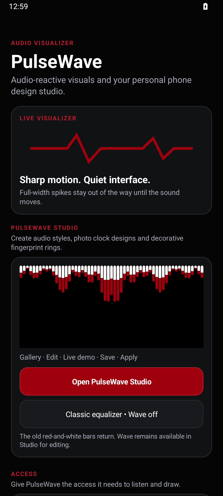

# PulseWave 🎵

**Open-source Android music visualizer with a customizable top-edge equalizer and PulseWave Studio.**

[**Download the latest public pre-release (v0.2.0)**](https://github.com/jerry090900/Pulse_Wave/releases/tag/v0.2.0-preview) · [Report a bug](https://github.com/jerry090900/Pulse_Wave/issues) · [MIT license](LICENSE)

> **Preview software, not a stable 1.0 release.** The visual appearance and OEM compatibility still need real-device validation. The Muviz-inspired color effects are experiments, not a pixel-perfect clone or an officially affiliated product.

## Features

- **Classic equalizer** — original red/white bars, full-width top placement and downward music-responsive movement.
- **PulseWave Studio** — multiple audio designs; edit widths, gaps, height, sensitivity, colors, Wave thickness, baseline, curvature, glow and opacity. Save, duplicate and apply local presets.
- **Custom color controls** — separately selectable A/B/C colors, side-by-side 3 lines and an optional **Muviz-style Color Layers** mode with moving cyan/white/pink sections within each bar.
- **Optional beat-response support** — Beat Sync Pro, adaptive visual sensitivity, and Smooth/Balanced/Punchy response; OFF by default, so the established music capture stays unchanged.
- **Service controls** — turn the visualizer off from its notification, optionally keep the overlay visible while PulseWave is open, or reset only the visualizer settings without deleting saved designs or selected apps.
- **Selected music apps** — control which chosen foreground media apps trigger the overlay. Optional user-authorized media-session detection is available.
- **Experimental screen-on lock-screen support**; availability varies by Android and device. This app cannot replace the system AOD or secure lock screen.

## Screenshots



*Genuine v0.2.0 main-screen screenshot on a clean Android 15 emulator. No real music was playing in the emulator; the Live Visualizer card demonstrates the interface, not verified live music response. Appearance on Nothing Phone and other devices may vary.*

[View the full screenshot](https://github.com/jerry090900/Pulse_Wave/releases/download/v0.2.0-preview/pulsewave-v0.2.0-emulator-home.png)

## Installation and updates

1. Open [GitHub Releases](https://github.com/jerry090900/Pulse_Wave/releases), choose the newest approved Preview version, and download the **APK** under Assets (not the source archive).
2. Install it on Android 10 or newer. Allow overlay and audio visualization permissions when prompted; Usage Access supports the selected-app feature. Notification listener access is optional.
3. Future signed Preview APKs can install **over the previous signed Preview** without uninstalling. The package is `com.jerry.sharpwave.preview`; new versions must have the same signing certificate and a higher version code.
4. The original `com.jerry.sharpwave` is a different application identity. Preview APKs **cannot** update it; do not uninstall the original app to test Preview.

PulseWave does not request internet permission. Audio is used locally for visual effects and is not recorded or uploaded. Notification listener access, when enabled, has broad system permission but the implementation processes only selected playing-session package IDs/state, not message content.

## Build and develop

The stable user-facing release track is [`preview/updateable`](https://github.com/jerry090900/Pulse_Wave/tree/preview/updateable). The repository's `main` branch is a retained older baseline, not the source for v0.2.0.

Requirements: Java 17, Android SDK/Build Tools 36, Gradle 9.6.0. Run:

```bash
gradle :app:testDebugUnitTest
gradle :app:assembleDebug
```

Local default debug APKs are **not** guaranteed to update the published app: release signing requires a permanent private owner-controlled key. Never commit `.jks`, `.p12`, passwords, or secret files. See [Updateable Preview signing guide](docs/UPDATEABLE_PREVIEW.md).

Release procedure: test changes in a PR, merge approved work into `preview/updateable`, produce and verify a permanently signed APK, and update the pinned release manifest for a **new** version tag. The dedicated publishing workflow verifies the APK hash, package, version code, and signing identity before creating a pre-release; it does not rewrite past releases.

## Limitations

Android's output-mix `Visualizer` API can give different results across audio apps and Bluetooth devices. Top-edge overlays, notification actions, lock-screen drawing and visual timing need testing on actual phones. Studio's preview uses simulated audio rather than a live song. The color-layer effect is still evolving based on real user feedback.

Licensed under [MIT](LICENSE). Contributions and useful bug reports are welcome.
